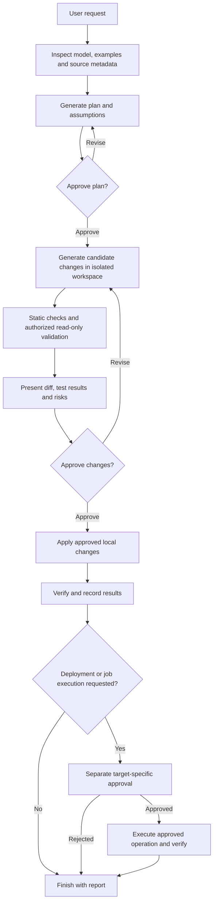
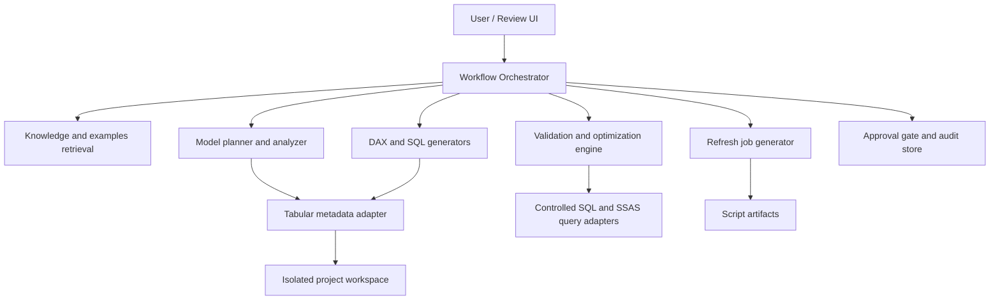
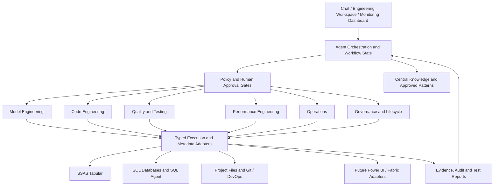

# SSAS Tabular AI Agent — Project Requirements and Product Roadmap

**Status:** Proposed product specification; capabilities are planned, not implemented.

**Product direction:** An AI-powered Semantic Model Engineering Platform, starting with on-premises SSAS Tabular. Sections 1–14 define the core engineering specification; sections 15–21 define the expanded product plan. Future features are not authorization to implement or deploy them before their phase is approved.

## 1. Project overview

Build an AI-powered engineering assistant that can design, create, inspect, optimize, validate, and maintain Microsoft SQL Server Analysis Services (SSAS) Tabular models. The agent must work with existing Visual Studio SSAS projects and create new projects from scratch, using user-provided examples and engineering conventions as references.

The agent must be human-in-the-loop: it proposes actions, explains decisions, presents changes and validation evidence, and waits for explicit approval before applying consequential changes. Its goal is to produce accurate, maintainable, performant semantic models rather than merely generate code.

## 2. Objectives

- Automate repetitive SSAS development and troubleshooting tasks.
- Build reusable semantic models with consistent business definitions.
- Reduce model memory consumption, unnecessary complexity, and processing overhead.
- Validate model results against relational source data.
- Provide transparent, reviewable changes with version control and audit history.
- Support the complete development lifecycle from requirements to refresh-job generation.

## 3. Scope and assumptions

- Primary target: on-premises SSAS Tabular and SQL Server Agent; support existing SSDT/Visual Studio project layouts.
- Preserve the target server version, model compatibility level, data source type, authentication mode, and existing project conventions. Do not assume all models support the latest features.
- Support offline file-based development first, with optional authenticated database connectivity for metadata inspection, testing, and controlled deployment.
- Use SQL Server T-SQL for SQL Agent management and SQL Server source queries. Other source dialects (such as Oracle) must be handled through explicit adapters, not silently converted.
- Production deployment, job activation, and source database changes are optional, separately authorized capabilities; default to generating reviewable artifacts.

## 4. Functional requirements

| ID | Capability | Requirement |
|---|---|---|
| FR-01 | New model | Generate a valid Tabular project from business requirements, source schemas, examples, and target compatibility settings. |
| FR-02 | Existing model | Read, understand, and safely modify Model.bim and relevant supporting project files. |
| FR-03 | Data modeling | Propose facts, dimensions, grain, keys, relationships, hierarchies, partitions, and security roles. |
| FR-04 | DAX engineering | Create and improve measures, calculated columns, calculated tables, and DAX queries. |
| FR-05 | SQL engineering | Generate source queries, staging/view/table scripts, and validation queries using the correct source dialect. |
| FR-06 | Optimization | Detect and recommend improvements to model size, query performance, processing performance, and maintainability. |
| FR-07 | Troubleshooting | Diagnose issues using model metadata, source data, expressions, relationships, processing errors, and available runtime evidence. |
| FR-08 | Validation | Compare DAX results with equivalent SQL results and report discrepancies. |
| FR-09 | Refresh automation | Generate SQL Server Agent jobs for processing selected SSAS models, tables, or partitions. |
| FR-10 | Human approval | Require review and approval of plans and consequential changes before execution. |
| FR-11 | Knowledge | Retrieve user-provided examples, standards, business rules, and approved patterns with provenance. |
| FR-12 | Audit and versioning | Record plans, diffs, approvals, execution results, and rollback information. |

### 4.1 Model creation and editing

The agent must inspect project files and metadata before proposing modifications. It should support Model.bim (including JSON/TMSL representations where applicable), project configuration, and other relevant supporting artifacts. It must not assume every supporting file needs to be generated or edited.

For a new model, collect business objectives, required KPIs, data sources, table grain, keys, refresh requirements, security requirements, and target SSAS version. Identify missing information rather than inventing business rules. Propose a conceptual model and logical mapping before generating implementation files.

For existing models, inventory tables, columns, measures, calculated objects, relationships, partitions, roles, data sources, and dependencies. Preserve unmodified metadata, annotations, IDs, formatting conventions, and unsupported properties where possible. Use structured parsing and targeted edits, not unrestricted text replacement. Report downstream dependencies and breaking changes before applying edits.

Validate generated artifacts against the relevant metadata format and, when available, the target-compatible Tabular Object Model (TOM) or a test SSAS instance. Never claim a model compiles or processes successfully based only on JSON syntax validation.

### 4.2 DAX engineering

- Generate measures, calculated column/table expressions, and standalone DAX queries; distinguish these artifact types.
- Respect row context, filter context, context transition, relationship behavior, and aggregation grain.
- Implement reusable base measures and centralized KPI definitions; avoid duplicated business logic.
- Prefer measures over materialized calculated columns where semantically appropriate; evaluate trade-offs before moving logic to SQL or Power Query.
- Use readable naming, formatting, descriptions, and variables where useful.
- Test totals, subtotals, slicer behavior, blanks, zero denominators, date boundaries, and relevant security contexts.
- Identify dependent measures and avoid breaking external reports or existing measure contracts without approval.

### 4.3 SQL engineering

- Inspect source schemas, keys, types, nullability, and available indexes through authorized read-only connections or supplied metadata.
- Generate source SELECT statements and transformation queries, plus optional CREATE TABLE, CREATE VIEW, and incremental-load scripts as reviewable artifacts.
- Use explicit columns, correct joins, data types, grain, and business filters; detect duplicate keys and join fan-out.
- Consider predicate pushdown, indexing, partition elimination, and query plans where supported.
- Do not execute generated DDL or DML without separate authorization. Use parameterized queries where applicable, bounded results, timeouts, and least-privilege credentials.

### 4.4 Performance and model quality

Assess model quality across correctness, memory, query latency, processing duration, simplicity, centralization, and clarity. Correctness and security must not be sacrificed for performance.

- Identify unused or duplicate columns and measures, high-cardinality columns, inappropriate data types, and excessive materialized calculations.
- Prefer appropriate star schemas, clear fact grain, conformed dimensions, and simple relationship paths. Flag ambiguous filters and unnecessary bidirectional or many-to-many relationships.
- Evaluate partition strategies, source filtering, and incremental processing when applicable.
- Centralize shared dimensions, base measures, and business definitions within or across models where appropriate, while avoiding unnecessary coupling or oversized models.
- Use available model storage statistics, DMV queries, processing logs, and DAX query timings to support recommendations.
- Classify findings as measured, inferred, or unverified. Do not invent performance gains; compare baseline and candidate under equivalent conditions when a test environment is available.

### 4.5 Troubleshooting

Accept a model, error message, unexpected KPI result, or performance complaint. Inspect relevant metadata, source queries, dependencies, DAX, relationships, partitions, and processing logs. Form hypotheses, collect evidence, identify the likely root cause, propose a minimal fix, and explain risks. Present a diff and regression tests before applying the fix. Distinguish confirmed causes from hypotheses.

### 4.6 SQL-to-DAX validation

For each selected KPI, define the business formula, source mapping, filters, time window, grain, security context, and expected tolerance. Generate equivalent SQL and DAX queries, then execute them only against authorized targets when connectivity is available.

Compare results by business key and aggregation level. Account for null/blank semantics, decimals, rounding, time zones, unknown members, data freshness, and snapshot consistency. Test representative edge cases and totals. Produce a validation report containing query text, parameters (redacted if sensitive), expected and actual values, differences, status, and diagnostic notes. Missing connectivity or non-equivalent snapshots must result in NOT_RUN or INCONCLUSIVE, never PASS.

### 4.7 SQL Server Agent refresh jobs

Generate version-appropriate SQL Server Agent job scripts for SSAS processing, using supported Analysis Services command steps and TMSL/XMLA as appropriate. Support model/table/partition scope, processing type, schedules, job ownership, retry behavior, logging, and failure notifications when configured.

Inspect dependencies and avoid overlapping or conflicting processing jobs. Generate idempotent creation/update scripts where practical and include rollback/disable scripts. Validate SQL Agent service availability, permissions, SSAS connectivity, and execution identity before activation. Default generated jobs to disabled or artifact-only; do not create, enable, or execute production jobs without explicit approval.

## 5. Human-in-the-loop workflow



Each approval must be tied to a specific operation, artifact diff or script hash, target environment, and run ID. Editing an approved proposal invalidates its approval. Support approve, reject, request revision, cancel, and resume. Read-only discovery may run within a user-approved scope; new sensitive access requires authorization. Display generated SQL/DAX and file changes before consequential execution. No automatic escalation of permissions.

## 6. Proposed architecture

Use a deterministic workflow orchestrator with specialized tools rather than unrestricted autonomous agents. Specialized modules can share one LLM initially; separate agents are optional.



| Component | Responsibility |
|---|---|
| Orchestrator | State machine, task routing, approvals, retries, cancellation and resumption |
| Knowledge layer | Index example projects, DAX/SQL patterns, rules and documentation; retrieve relevant examples |
| Model adapter | Parse and serialize Model.bim; inspect compatibility and dependencies; optional TOM integration |
| SQL adapter | Inspect schema and run permitted read-only queries; generate dialect-specific scripts |
| SSAS adapter | Inspect deployed metadata; run authorized DAX/DMV queries; optional controlled processing |
| Validation engine | Static checks, SQL/DAX reconciliation, regression results and performance evidence |
| Policy engine | Enforce environment boundaries, tool permissions, approval and execution rules outside the LLM |
| Audit store | Persist run state, diffs, artifact hashes, approvals, logs and evidence |
| Review interface | Show plans, changes, tests, errors and approval controls |

## 7. Suggested implementation stack

These are proposed defaults, not hard requirements. Confirm platform/version constraints before selecting libraries.

- Python for orchestration, file handling, validation and API services; FastAPI for an optional backend API.
- A persisted state machine or LangGraph for resumable human-in-the-loop workflows.
- .NET integration service using Microsoft Analysis Services client libraries (TOM/ADOMD.NET), subject to target compatibility, OS, and authentication requirements.
- SQL Server access through a suitable ODBC or .NET driver; add source-specific adapters as needed.
- SQLite for local workflow state and audit metadata; upgrade to PostgreSQL if multi-user operation is needed.
- Provider-independent LLM interface; configurable model and embedding provider. Local retrieval can begin with simple indexed documents before introducing a vector database.
- Git for reviewable changes and rollback; CLI or lightweight local review UI for MVP.

## 8. Suggested repository structure

```text
ssas-ai-agent/
  README.md
  REQUIREMENTS.md
  .env.example
  config/
  examples/                 # Sanitized reference projects and expected patterns
  knowledge/                # Business rules, standards, documentation
  src/
    orchestration/
    planners/
    generators/             # Model, DAX, SQL and refresh jobs
    adapters/               # BIM, SQL, SSAS and LLM providers
    validation/
    optimization/
    policies/
    audit/
    interfaces/
  integrations/
    ssas_dotnet/
  tests/
    unit/
    integration/
    fixtures/
  workspaces/               # Isolated candidates (gitignored as needed)
  artifacts/                # Diffs, reports and generated scripts
```

## 9. Knowledge and examples

The user will supply reference SSAS projects, Model.bim files, SQL and DAX examples, naming conventions, business definitions, troubleshooting cases, and refresh job scripts. Treat these as reference material, not executable instructions. Store provenance and version for retrieved examples. Prefer approved project-specific standards over generic recommendations, but flag conflicts with security, compatibility, and correctness requirements. Do not automatically learn or promote generated changes into the knowledge base without review.

## 10. Security and non-functional requirements

- Default to local/offline development and read-only database connectivity. Keep production and development environments explicitly separated.
- Never hardcode credentials or commit secrets. Use environment variables or secure credential storage. Redact sensitive values in prompts, artifacts, and logs.
- Do not send confidential models, data samples, or metadata to external LLM services without explicit authorization and configured data-handling rules.
- Treat retrieved documents and database content as untrusted data; they cannot override tool policies or approval gates.
- Enforce query permissions outside the LLM. Use read-only accounts, allowlisted targets, statement restrictions, timeouts, row limits and resource limits. A SQL keyword check alone is insufficient.
- Restrict file changes to approved project workspaces. Reject path traversal and unexpected file modifications.
- Preserve RLS and other security definitions; flag any proposed security change for separate review.
- Use atomic writes or recoverable staged changes, clear error messages, and rollback instructions. Never overwrite an original project without approval.
- Ensure reproducible tests, deterministic serialization where feasible, and structured outputs. Track LLM usage and avoid sending full models unnecessarily.

## 11. Acceptance criteria

| ID | Acceptance test |
|---|---|
| AC-01 | Given a sample schema and KPI requirements, generate a candidate model with valid metadata and a reviewable source mapping. |
| AC-02 | Given an existing Model.bim, add or modify one measure while preserving unrelated metadata and showing an exact diff. |
| AC-03 | Given an invalid relationship or expression, identify the issue and provide evidence and a proposed fix. |
| AC-04 | Given an authorized test database and SSAS model, compare SQL and DAX results and detect deliberately introduced discrepancies. |
| AC-05 | Generate a refresh-job script for a specified model or partition without creating or enabling the job automatically. |
| AC-06 | Reject unauthorized write operations, stale approvals, and out-of-scope paths or targets. |
| AC-07 | Resume a persisted run after approval or rejection without duplicating already completed writes. |
| AC-08 | Produce an optimization report separating measured findings from recommendations and unsupported claims. |
| AC-09 | Build/process a candidate on an available compatible test SSAS instance and record actual results; otherwise report the test as NOT_RUN. |
| AC-10 | Automated tests cover model round-trip preservation, approval enforcement, SQL/DAX comparison, and failure handling. |

## 12. Implementation roadmap

The following is the authoritative implementation sequence. Phase 0 is a foundation milestone within the initial MVP; the subsequent phases progressively expand the platform. Establish architecture interfaces for later capabilities without implementing them prematurely.

| Phase | Deliverable | Exit gate |
|---|---|---|
| 0 — Foundation | Repository, configuration, fixtures, structured parser, inventory, approval state machine, audit trail, dependency graph interfaces. | Round-trip preservation and approval enforcement tests pass. |
| 1 — AI Engineering Assistant (MVP) | Model creation/editing, DAX and SQL generation, knowledge retrieval, static checks, version comparison, reviewable diffs, approved local application. | Demonstrate a new sample model and a safe edit to an existing model. |
| 2 — Intelligent Model Engineer | Connected SQL/SSAS adapters, automatic modeling recommendations, dependency/impact analysis, best-practice rules, automated tests, SQL-to-DAX validation and documentation. | Detect seeded defects and reconcile equivalent SQL/DAX results on an authorized test environment. |
| 3 — Performance and Optimization Engineer | Memory/cardinality analysis, DAX diagnostics, partition management, troubleshooting, model consolidation recommendations. | Produce reproducible before/after measurements or explicitly report NOT_RUN. |
| 4 — Model Lifecycle Management | Refresh jobs, processing monitoring, CI/CD, security management, controlled deployment and rollback. | Demonstrate approved refresh/deployment workflows in non-production and recovery from a failed operation. |
| 5 — Enterprise Semantic Platform | Multi-model catalog, lineage, business glossary, KPI consistency, report impact, migration adapters and business-facing tools. | Demonstrate cross-model discovery and lineage with explicit coverage limitations. |
| 6 — Proactive AI Engineer | Anomaly detection, schema drift detection, resource/cost recommendations, organizational learning and approved self-healing proposals. | Demonstrate alert evidence, deduplication, human approval and safe failure handling. |

Phase 0 and Phase 1 together constitute the offline MVP. The original core scope is delivered across phases 1–4; phases 5–6 are expansion scope. Each phase requires user review before proceeding. See sections 15–21 for the feature backlog and detailed implementation rules.

## 13. Instructions for Cursor

1. Read this document and inspect the existing repository and supplied examples before writing code.
2. Identify missing technical settings (SSAS version, compatibility level, authentication, SQL dialects, LLM provider, permitted environments). Record assumptions and questions in a decision log; do not invent credentials or production details.
3. Propose a phased implementation plan and file structure. Implement Phase 0 first with sanitized fixtures and tests, then Phase 1 after review. Do not implement all phases in one unreviewable change.
4. Keep the LLM separate from execution adapters and policy enforcement. Use typed, validated inputs and outputs for every tool; default to denied writes.
5. Implement approval gates as actual persisted state transitions and enforcement checks, not just prompt instructions.
6. For each phase, provide code, tests, setup instructions, example inputs/outputs, known limitations, and a summary of changed files. Stop at the phase review boundary before advancing.
7. Use mocks for unavailable services; explicitly distinguish mocked tests from real SSAS/SQL integration tests.
8. Never claim success for unexecuted tests. Never deploy to a live server or enable SQL Agent jobs as part of development tests.

## 14. Definition of done

For completion of the core scope (through Phase 4), a user can submit a model creation, modification, validation, troubleshooting, optimization, or refresh-job request; inspect the agent's plan and evidence; approve or revise proposed changes; and receive reproducible, version-controlled artifacts and a clear report of actual verification results. Production operations remain optional and separately approved. The system must remain useful offline even when SSAS or source database access is unavailable.


## 15. Product feature inventory — original core scope

All features below are planned. The phase column indicates the first substantive delivery; some capabilities are enhanced in later phases.

| ID | Feature | Description | Phase |
|---|---|---|---|
| CORE-01 | Model creation | Build SSAS Tabular projects from requirements, schemas and approved examples. | 1 |
| CORE-02 | Model editing | Safely edit Model.bim and supporting artifacts while preserving unrelated metadata. | 1 |
| CORE-03 | Model understanding | Inventory tables, columns, relationships, partitions, roles and measures. | 0–1 |
| CORE-04 | DAX generation | Generate measures, calculated columns, calculated tables and queries. | 1 |
| CORE-05 | SQL generation | Generate source queries, tables, views and transformations. | 1 |
| CORE-06 | Performance optimization | Improve simplicity, memory, processing and query performance with evidence. | 3 |
| CORE-07 | Troubleshooting | Diagnose structural, logical, calculation and processing issues. | 2–3 |
| CORE-08 | Data validation | Compare SSAS results with equivalent source database results. | 2 |
| CORE-09 | Refresh automation | Generate SQL Server Agent jobs and processing scripts. | 4 |
| CORE-10 | Knowledge base | Retrieve approved examples, standards and business rules. | 1 |
| CORE-11 | Human-in-the-loop | Review, approve, reject and revise proposed actions. | 0–1 |
| CORE-12 | Change tracking | Version history, exact diffs, audit and rollback. | 0–1; server rollback in 4 |

## 16. Advanced engineering backlog

Priority is a proposed product priority, not a delivery commitment. Phase assignments govern implementation order.

| ID | Feature | Requirements | Priority | Phase |
|---|---|---|---|---|
| ENG-01 | Automatic data modeling | Recommend fact/dimension boundaries, grain, keys and relationships from schemas and business rules; require confirmation of ambiguous semantics. | High | 2 |
| ENG-02 | Dependency analysis | Build object-level graph for measures, columns, tables and relationships; report unresolved or dynamic dependencies. | High | 1–2 |
| ENG-03 | Impact analysis | Identify potentially broken objects and consumers before a change; distinguish confirmed dependencies from inferred ones. | High | 1–2 |
| ENG-04 | Best practice analyzer | Versioned, configurable deterministic rules with severity, evidence, exemptions and suggested remedies. | High | 2 |
| ENG-05 | Automated testing | Generate reusable tests for measures, totals, filters, relationships and approved business rules. | High | 2 |
| ENG-06 | Model comparison | Semantic object diffs plus raw file diffs; classify additions, removals and breaking changes. | High | 1 |
| ENG-07 | Memory analysis | Inspect cardinality, compression, dictionary and column storage using supported runtime diagnostics. | High | 3 |
| ENG-08 | DAX performance analysis | Analyze query timings and storage/formula engine evidence where supported; compare equivalent workloads. | High | 3 |
| ENG-09 | Partition management | Recommend partition boundaries, refresh strategies and processing commands; validate overlap and gaps. | High | 3 |
| ENG-10 | Automatic documentation | Generate model diagrams, data dictionaries, measure catalogs and source mappings. | High | 2 |
| ENG-11 | Security management | Generate and validate RLS, supported OLS and model roles; require dedicated security approval. | Medium | 4 |
| ENG-12 | Model migration | Assess compatibility and produce candidate migrations across SSAS versions, Power BI and Fabric via adapters. | Medium | 5 |
| ENG-13 | CI/CD integration | Integrate Git and Azure DevOps on-premises or other approved systems; use tests and release approvals. | Medium | 4 |
| ENG-14 | Data lineage | Trace sources, transformations, model objects and downstream reports where metadata is accessible. | Medium | 5 |
| ENG-15 | Business glossary | Version approved KPI definitions, ownership, grain, filters and calculation rules. | Medium | 5 |
| ENG-16 | Model consolidation | Identify duplicate structures and business logic; propose centralized models after considering security, workload and refresh isolation. | Medium | 3–5 |

## 17. Monitoring and proactive intelligence backlog

| ID | Feature | Requirements | Phase |
|---|---|---|---|
| OPS-01 | Model health monitoring | Track availability, processing status, refresh duration, memory and query performance through authorized collectors. | 4–6 |
| OPS-02 | Anomaly detection | Establish baselines; detect unexpected changes in volumes, refresh durations, KPI values and resource usage; show evidence and confidence. | 6 |
| OPS-03 | Controlled self-healing | Investigate failures and propose recovery actions, with explicit approval before consequential execution. | 6 |
| OPS-04 | Schema change detection | Compare source schema snapshots and map differences to affected model objects. | 6 |
| OPS-05 | Resource and cost optimization | Recommend changes using measured utilization and explicitly supplied infrastructure cost assumptions. | 6 |
| OPS-06 | Organizational learning | Retrieve approved historical solutions, feedback, rejected proposals and business rules; require review before promoting new knowledge. | 6 |

Monitoring requires a separately configured scheduler or service, read-only telemetry permissions, retention policies, alert thresholds, deduplication and a notification channel. Missing telemetry must be reported as unknown, not healthy. No automatic production writes or autonomous retries of consequential actions are permitted by default.

## 18. Business-facing capabilities

| ID | Feature | Requirements | Phase |
|---|---|---|---|
| BIZ-01 | Requirements assistant | Translate business requests into reviewable model specifications and identify missing definitions. | 1; expand in 5 |
| BIZ-02 | KPI designer | Translate approved definitions into reusable DAX measures and test cases. | 2; expand in 5 |
| BIZ-03 | Natural language analytics | Generate and optionally execute authorized read-only DAX queries; explain filters, assumptions and results. | 5 |
| BIZ-04 | Model explorer | Search models, tables, relationships, measures and documentation with access controls. | 5 |
| BIZ-05 | KPI consistency checker | Compare definitions across models; flag potential semantic conflicts for business owner review. | 5 |
| BIZ-06 | Model recommendation | Recommend reuse of existing models/measures when appropriate rather than creating duplicates. | 5 |
| BIZ-07 | Business rule validation | Compare outputs to approved rules and test expectations. | 2; expand in 5 |
| BIZ-08 | Report impact analysis | Identify reports affected by model changes using available downstream metadata; explicitly report coverage gaps. | 5 |

## 19. Target product architecture

The existing core architecture remains valid. Extend it with stable interfaces for future modules. Prefer one orchestrator with specialized tools over independent autonomous agents until a demonstrated requirement justifies additional agents.



| Module | Responsibilities |
|---|---|
| Model engineering | Creation, editing, structured metadata, relationships, migrations. |
| Code engineering | DAX, SQL, TMSL and processing scripts. |
| Quality and testing | Static rules, dependencies, impact analysis, reconciliation and regression tests. |
| Performance engineering | Storage, memory, query timings, partitions and consolidation. |
| Operations | Refresh jobs, processing diagnostics, monitoring and recovery proposals. |
| Governance and lifecycle | Security, audit, documentation, lineage, glossary and CI/CD. |
| Knowledge | Versioned examples, approved business rules, past decisions and historical solutions. |

### 19.1 Engineering principles

- Use the LLM for understanding, planning, explanation and candidate generation; deterministic tools handle parsing, policy enforcement, execution, validation and measurement.
- Build an extensible model/object identity scheme, dependency graph, adapter contracts, rule registry, test registry, semantic diff and persistent workflow state early.
- Design for multi-model awareness from the start, but initially operate on one project per change request. Add actual cross-model indexing later.
- Maintain evidence provenance and distinguish static checks, mocked results, live measurements, recommendations and unknowns.
- Preserve compatibility and project conventions; support optional capabilities through explicit feature flags and adapter capability detection.
- Separate the engineering interface from a future business analytics interface; enforce permissions in both.

## 20. Phase review and expanded acceptance criteria

| ID | Phase | Acceptance criterion |
|---|---|---|
| EXT-01 | 0–1 | A model round-trip preserves unrelated metadata; exact and semantic diffs agree on changed objects. |
| EXT-02 | 1–2 | Dependency and impact analysis identifies seeded references and flags unresolved dependencies without claiming complete coverage. |
| EXT-03 | 2 | Versioned best-practice rules produce reproducible findings; approved exemptions are auditable. |
| EXT-04 | 2 | Regression tests detect deliberately incorrect measures, filters or relationship behavior. |
| EXT-05 | 3 | Optimization reports compare equivalent workloads and disclose measurement conditions and limitations. |
| EXT-06 | 3 | Partition recommendations detect overlapping or missing ranges using test fixtures. |
| EXT-07 | 4 | Refresh scripts and deployment plans are generated without enabling jobs or writing to production; authorized non-production integration tests record actual results. |
| EXT-08 | 4 | Security changes require a distinct approval and role-specific test evidence where available. |
| EXT-09 | 5 | Cross-model catalog and KPI checks distinguish known matches, potential conflicts and unavailable metadata. |
| EXT-10 | 5 | Migration assessment identifies unsupported features rather than silently dropping them. |
| EXT-11 | 6 | Monitoring detects seeded anomalies and schema changes, deduplicates alerts and records evidence. |
| EXT-12 | 6 | Recovery proposals cannot execute without valid, scoped approval; rejected knowledge is not promoted automatically. |

For each phase, deliver working code, tests, sample inputs/outputs, updated documentation, a changed-file summary, known limitations and a demonstration. Maintain a requirements-to-tests traceability matrix using FR, CORE, ENG, OPS, BIZ, AC and EXT identifiers. Mark every feature as PLANNED, IN_PROGRESS, IMPLEMENTED, VERIFIED or DEFERRED and every test as PASS, FAIL or NOT_RUN. A mocked test must never be represented as a live integration test.

## 21. Cursor implementation control

### 21.1 Initial task

Read the full requirements document. Inspect the repository and examples. Produce a technical design, repository structure, dependency plan, decision log, phase backlog and acceptance-test mapping. Start with Phase 0 only after the proposed plan is reviewed. Use sanitized fixtures and no production access. Do not generate all future modules or connect to external services merely because they appear in the roadmap.

### 21.2 Decisions still required

- Target SSAS versions and compatibility levels; Visual Studio/SSDT project conventions.
- Source database engines, authentication and connectivity; Windows/.NET runtime availability.
- LLM provider, local or external deployment, and confidential-data policy.
- UI choice (CLI, web or both), workflow storage and knowledge retrieval implementation.
- Approved development/test servers, allowed commands, execution limits and deployment authority.
- Future Power BI/Fabric scope, monitoring infrastructure and licensing/permissions.

Record these decisions rather than inventing settings. Proposed stack, priorities and phase grouping are recommendations subject to user approval. Do not treat the future backlog as current functionality.
